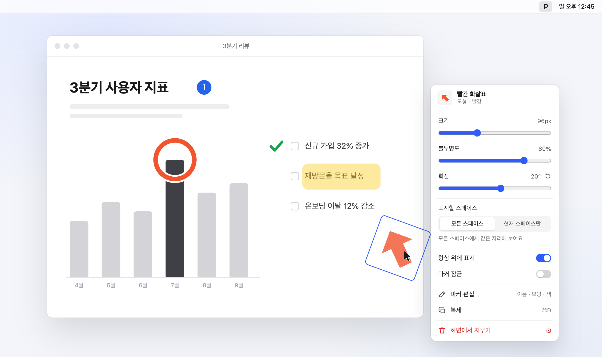
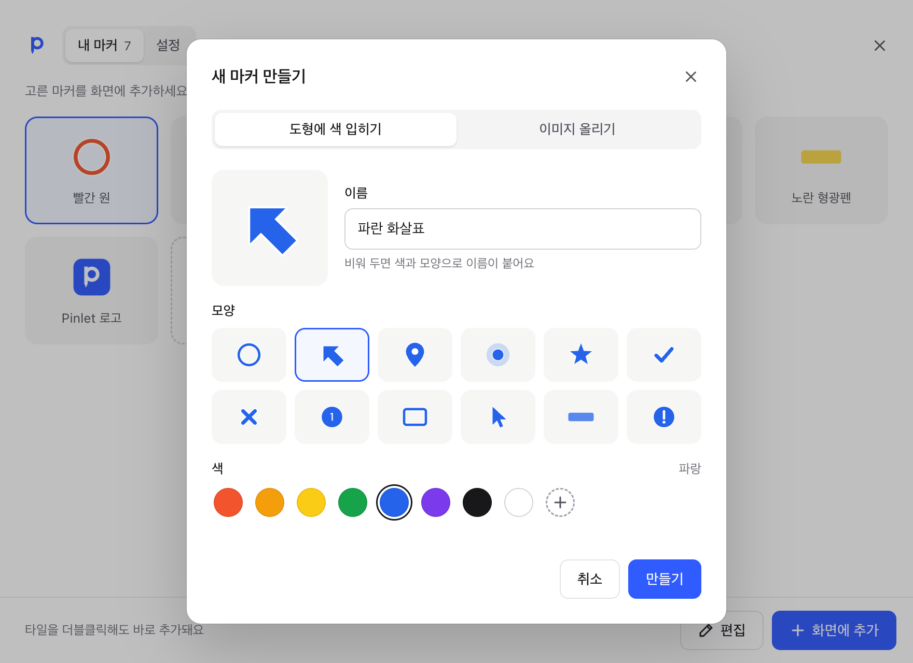
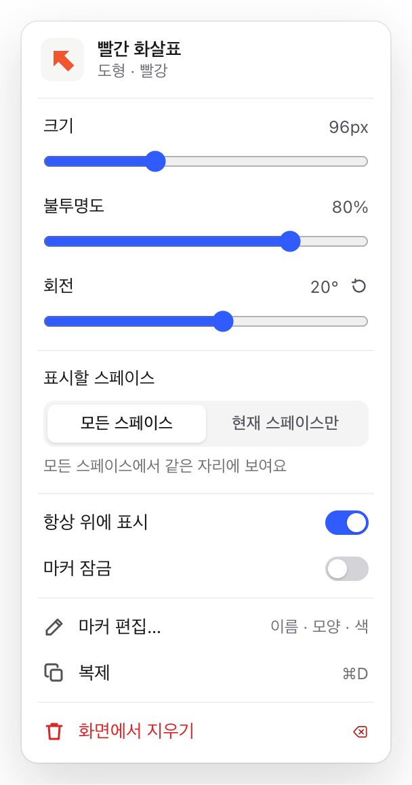
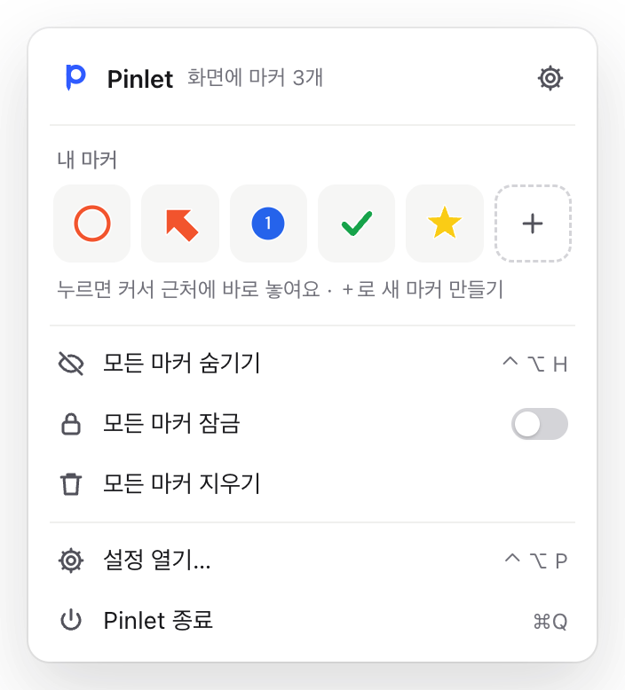

<div align="center">


# Pinlet

화면 위 어디에나 마커를 띄워 두는 데스크톱 앱

[](https://github.com/eatyasic/Pinlet/releases/latest)
[](https://github.com/eatyasic/Pinlet/releases)
[](#다운로드)
[](https://www.electronjs.org)
[](LICENSE)

<a href="https://github.com/eatyasic/Pinlet/releases/latest/download/Pinlet-mac-arm64.dmg"></a>
<a href="https://github.com/eatyasic/Pinlet/releases/latest/download/Pinlet-mac-x64.dmg"></a>
<a href="https://github.com/eatyasic/Pinlet/releases/latest/download/Pinlet-Setup-x64.exe"></a>

<br><br>



</div>

<br>

화면 위에 마커를 고정해 두고, 크기 · 불투명도 · 회전을 마커 우클릭 메뉴에서 바꾼다.

OS 기본 기능으로는 화면 특정 위치에 표시를 고정해 둘 수 없다 → 발표 · 녹화 · 튜토리얼 중 무언가를 가리키려면 커서를 계속 올려 두거나 영상 편집으로 덧그려야 한다.

Pinlet은 마커마다 투명한 always-on-top 창을 하나씩 띄우고, 마커 바깥의 투명한 영역은 클릭을 아래 창으로 넘긴다. 따라서 마커를 띄워 둔 채로 다른 앱을 그대로 쓸 수 있다.

---

## 다운로드

| OS | 파일 | 크기 |
| --- | --- | --- |
| macOS 12 이상 · Apple Silicon | [`Pinlet-mac-arm64.dmg`](https://github.com/eatyasic/Pinlet/releases/latest/download/Pinlet-mac-arm64.dmg) | 114MB |
| macOS 12 이상 · Intel | [`Pinlet-mac-x64.dmg`](https://github.com/eatyasic/Pinlet/releases/latest/download/Pinlet-mac-x64.dmg) | 121MB |
| Windows 10 · 11 (64비트) | [`Pinlet-Setup-x64.exe`](https://github.com/eatyasic/Pinlet/releases/latest/download/Pinlet-Setup-x64.exe) | 116MB |

이전 버전과 변경 내역은 [Releases](https://github.com/eatyasic/Pinlet/releases)에 있다.

### 처음 실행할 때

코드 서명 · 공증을 하지 않은 빌드이므로 처음 한 번은 OS 경고를 넘겨야 한다.

- macOS : DMG를 열어 `Pinlet`을 `Applications`로 끌어 놓고 실행한다. 경고 창이 뜨면 `완료`를 누른 뒤 `시스템 설정 > 개인정보 보호 및 보안`에서 `그래도 열기`를 누른다.
- Windows : `Windows의 PC 보호` 창이 뜨면 `추가 정보 > 실행`을 누른다.

주의 : macOS에서 `손상되었기 때문에 열 수 없습니다`가 뜨면 다운로드 격리 속성을 지운 뒤 다시 연다.

```bash
xattr -dr com.apple.quarantine /Applications/Pinlet.app
```

---

## 기능

- 내 마커 : 도형 12종에 색을 입히거나 PNG · JPG · GIF · WEBP · SVG 이미지를 올려 만든다. 처음엔 빨간 원 하나로 시작한다.
- 마커 편집 : 이름 · 모양 · 색 · 이미지를 바꾸면 화면에 놓인 같은 마커도 함께 바뀐다.
- 우클릭 메뉴 : 크기( 24-240px ), 불투명도( 10-100% ), 회전( ±180° ), 표시할 스페이스, 항상 위에 표시, 마커 잠금, 복제, 화면에서 지우기
- 도구바 : 메뉴 막대( Windows는 작업 표시줄 트레이 )에서 마커 추가, 모두 숨기기, 모두 잠그기, 모두 지우기
- 잠금 : 잠긴 마커는 평소와 똑같이 보이고, 끌려고 할 때만 `잠긴 마커예요` 알림을 띄운다.
- 클릭 통과 : 마커 바깥의 투명한 영역을 누르면 아래 창이 클릭된다.
- 자동 저장 : 마커 위치와 설정은 앱을 다시 켜도 그대로 남는다.

<table>
<tr>
<td width="50%"><br>내 마커</td>
<td width="50%"><br>새 마커 만들기</td>
</tr>
<tr>
<td align="center"><br>마커 우클릭 메뉴</td>
<td align="center"><br>도구바 팝오버</td>
</tr>
</table>

### 단축키

전역 단축키는 다른 앱 단축키와 겹치지 않도록 `Control+Alt` 조합을 쓴다.

| 동작 | macOS | Windows |
| --- | --- | --- |
| 모든 마커 숨기기 · 보이기 | `⌃⌥H` | `Ctrl+Alt+H` |
| 모든 마커 잠금 · 해제 | `⌃⌥L` | `Ctrl+Alt+L` |
| Pinlet 창 열기 | `⌃⌥P` | `Ctrl+Alt+P` |
| 복제 ( 우클릭 메뉴 안 ) | `⌘D` | `Ctrl+D` |
| 화면에서 지우기 ( 우클릭 메뉴 안 ) | `⌫` | `Delete` |

### 플랫폼별 차이

- 표시할 스페이스 : macOS 전용이다. Electron이 Windows 가상 데스크톱 이동을 지원하지 않으므로 Windows에서는 우클릭 메뉴에서 이 항목을 숨긴다.
- 도구바 아이콘 : macOS는 흑백 템플릿 아이콘( 다크 모드에서 자동 반전 ), Windows는 파란 타일 아이콘을 쓴다.
- 창 닫기 : Pinlet 창을 닫아도 앱은 도구바에 남는다. 종료는 도구바 팝오버의 `Pinlet 종료`로 한다.

---

## 소스에서 실행

Node.js 22.12 이상이 필요하다.

```bash
git clone https://github.com/eatyasic/Pinlet.git
```

```bash
cd Pinlet && npm install
```

```bash
npm start
```

메뉴 막대에 P 아이콘이 생기고 Pinlet 창이 열린다.

주의 : npm 11 이상은 `allow-scripts` 정책 때문에 Electron 설치 스크립트를 건너뛸 수 있다. `npm start`에서 Electron 바이너리를 찾지 못하면 아래 명령으로 직접 내려받는다.

```bash
node node_modules/electron/install.js
```

### 빌드

```bash
npm run dist:mac
```

```bash
npm run dist:win
```

- `dist:mac` : Apple Silicon · Intel DMG를 각각 만든다. ad-hoc 서명만 하고 공증은 하지 않는다.
- `dist:win` : 64비트 NSIS 설치 파일을 만든다. macOS에서도 Wine 없이 빌드된다.

결과물은 `dist/`에 생긴다. macOS 빌드는 `LSUIElement`를 켜서 Dock에 아이콘을 띄우지 않는다.

### 화면 캡처 · 동작 확인

```bash
npm run snapshot
```

임시 프로필로 앱을 띄워 모든 창을 PNG로 저장하고, 드래그 · 잠금 · 우클릭 · 숨기기 · 저장을 합성 입력으로 확인해 `PASS` / `FAIL`을 출력한다. 실행하는 동안 창이 잠깐 화면에 나타났다 닫힌다.

### 구조

- `src/main/main.js` : 창 · 트레이 · 전역 단축키 · IPC
- `src/main/store.js` : 상태 저장( `userData/pinlet.json` )
- `src/main/images.js` : 사용자 이미지를 `userData/images/`로 복사 · 정리
- `src/preload.js` : 렌더러에 노출하는 `window.pinlet` API
- `src/renderer/pinlet.*` : Pinlet 창( 내 마커 · 설정 · 마커 만들기/편집 )
- `src/renderer/tray.*` : 도구바 팝오버
- `src/renderer/marker.*` : 화면 위 마커 창( 드래그 · 클릭 통과 · 우클릭 )
- `src/renderer/menu.*` : 마커 우클릭 메뉴
- `src/renderer/shared/glyphs.js` : 도형 SVG · 색 팔레트 · 아이콘
- `scripts/make-icons.js` : 앱 · 도구바 아이콘 PNG 생성( `npm run icons` )

데이터는 `userData` 폴더에 저장된다.

- macOS : `~/Library/Application Support/Pinlet/`
- Windows : `%APPDATA%\Pinlet\`

---

## 라이선스

[MIT](LICENSE)
