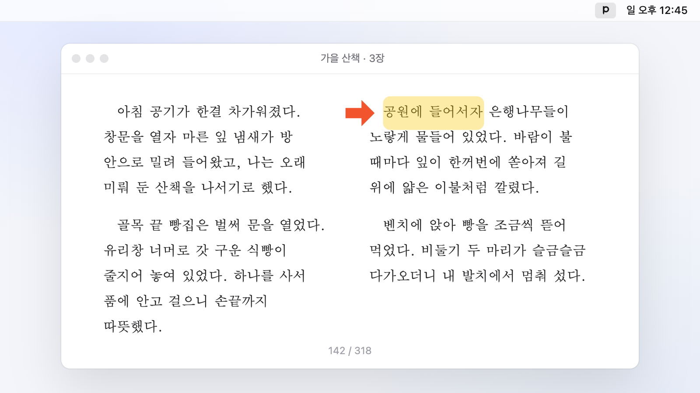
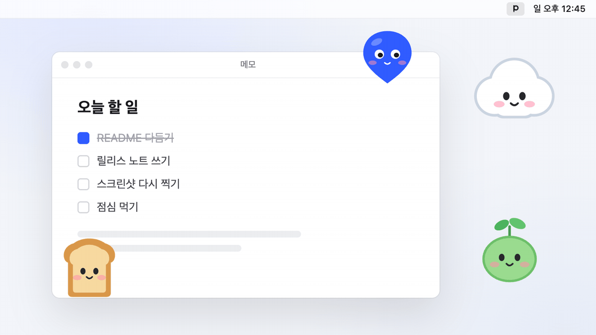

<div align="center">


# Pinlet

화면 어디에나 마커를 콕 붙여 두는 작은 데스크톱 앱

[](https://github.com/eatyasic/Pinlet/releases/latest)
[](https://github.com/eatyasic/Pinlet/releases)
[](#다운로드)
[](https://www.electronjs.org)
[](LICENSE)

<a href="https://github.com/eatyasic/Pinlet/releases/latest/download/Pinlet-mac-arm64.dmg"></a>
<a href="https://github.com/eatyasic/Pinlet/releases/latest/download/Pinlet-mac-x64.dmg"></a>
<a href="https://github.com/eatyasic/Pinlet/releases/latest/download/Pinlet-Setup-x64.exe"></a>

<br><br>


</div>

<br>

Pinlet은 화면 위에 마커를 띄워 두는 앱이에요. 원하는 자리에 끌어다 놓으면 다른 창을 아무리 오가도 그 자리에 그대로 떠 있어요. 크기, 투명도, 회전은 마커를 우클릭해서 바로 바꾸면 돼요.

마커 바깥의 투명한 부분은 클릭이 그대로 통과해요. 그래서 마커를 띄워 둔 채로 하던 일을 계속할 수 있어요.

---

## 이런 데 써요

### 발표하거나 화면을 녹화할 때

짚어 주고 싶은 곳에 동그라미나 화살표를 놓아 두세요. 커서를 계속 올려 두지 않아도 되고, 녹화한 영상에 나중에 덧그릴 필요도 없어요.

### 이북을 읽을 때



어디까지 읽었는지 자꾸 헷갈린다면 읽던 줄에 형광펜이나 화살표 마커를 하나 붙여 두세요. 잠깐 다른 창을 보고 와도 바로 이어서 읽을 수 있어요. `마커 잠금`을 켜 두면 실수로 밀릴 일도 없어요.

### 좋아하는 캐릭터를 데스크톱 친구로



좋아하는 캐릭터 이미지나 GIF를 마커로 올려서 화면 한쪽에 띄워 두세요. GIF는 움직이는 그대로 재생되고, 여러 마리를 한꺼번에 띄워도 돼요. `항상 위에 표시`를 켜 두면 어떤 창을 열어도 늘 곁에 있어요.

( 위 캐릭터들은 README 예시로 직접 그렸어요. 마커로는 원하는 어떤 이미지든 쓸 수 있어요. )

---

## 다운로드

| OS | 파일 | 크기 |
| --- | --- | --- |
| macOS 12 이상 · Apple Silicon | [`Pinlet-mac-arm64.dmg`](https://github.com/eatyasic/Pinlet/releases/latest/download/Pinlet-mac-arm64.dmg) | 114MB |
| macOS 12 이상 · Intel | [`Pinlet-mac-x64.dmg`](https://github.com/eatyasic/Pinlet/releases/latest/download/Pinlet-mac-x64.dmg) | 121MB |
| Windows 10 · 11 (64비트) | [`Pinlet-Setup-x64.exe`](https://github.com/eatyasic/Pinlet/releases/latest/download/Pinlet-Setup-x64.exe) | 116MB |

지난 버전과 바뀐 점은 [Releases](https://github.com/eatyasic/Pinlet/releases)에서 볼 수 있어요.

### 처음 열 때

아직 Apple · Microsoft 서명을 받지 않은 앱이라 처음 한 번은 경고가 떠요.

- **macOS** : DMG를 열고 `Pinlet`을 `Applications`로 옮긴 뒤 실행해 주세요. 경고 창이 뜨면 `완료`를 누르고, `시스템 설정 > 개인정보 보호 및 보안`에서 `그래도 열기`를 누르면 돼요.
- **Windows** : `Windows의 PC 보호` 창이 뜨면 `추가 정보 > 실행`을 눌러 주세요.

macOS에서 `손상되었기 때문에 열 수 없습니다`라고 나오면 터미널에서 아래 명령을 한 번 실행한 뒤 다시 열어 주세요.

```bash
xattr -dr com.apple.quarantine /Applications/Pinlet.app
```

---

## 기능

- **내 마커** — 도형 12가지에 색을 입히거나, PNG · JPG · GIF · WEBP · SVG 이미지를 올려서 만들어요. 처음엔 빨간 원 하나가 들어 있어요.
- **마커 편집** — 이름, 모양, 색, 이미지를 바꾸면 화면에 놓인 마커도 함께 바뀌어요.
- **우클릭 메뉴** — 크기( 24-240px ), 투명도( 10-100% ), 회전( ±180° ), 표시할 스페이스, 항상 위에 표시, 마커 잠금, 복제, 지우기
- **도구바** — 메뉴 막대( Windows는 트레이 )에서 마커를 바로 놓거나, 한 번에 숨기고 잠그고 지울 수 있어요.
- **잠금** — 잠긴 마커는 평소와 똑같이 보이고, 끌려고 할 때만 `잠긴 마커예요`라고 알려 줘요.
- **자동 저장** — 앱을 껐다 켜도 마커는 놓아 둔 자리 그대로예요.

<table>
<tr>
<td width="50%"><br>내 마커</td>
<td width="50%"><br>새 마커 만들기</td>
</tr>
<tr>
<td align="center"><br>마커 우클릭 메뉴</td>
<td align="center"><br>도구바 팝오버</td>
</tr>
</table>

### 단축키

다른 앱과 겹치지 않게 `Control+Alt` 조합을 써요.

| 동작 | macOS | Windows |
| --- | --- | --- |
| 모든 마커 숨기기 · 보이기 | `⌃⌥H` | `Ctrl+Alt+H` |
| 모든 마커 잠금 · 해제 | `⌃⌥L` | `Ctrl+Alt+L` |
| Pinlet 창 열기 | `⌃⌥P` | `Ctrl+Alt+P` |
| 복제 ( 우클릭 메뉴에서 ) | `⌘D` | `Ctrl+D` |
| 화면에서 지우기 ( 우클릭 메뉴에서 ) | `⌫` | `Delete` |

### macOS와 Windows가 조금 달라요

- **표시할 스페이스**는 Windows에선 `표시할 데스크톱`으로 나와요. 가상 데스크톱마다 마커를 띄울지 고를 수 있어요. 다만 Windows 11 24H2 · 25H2에서만 쓸 수 있고, 그보다 오래된 Windows에선 메뉴에서 빠져 있어요.
- **도구바 아이콘**은 macOS에선 흑백( 다크 모드면 자동으로 반전 ), Windows에선 파란 아이콘이에요.
- **창을 닫아도** 앱은 도구바에 남아 있어요. 완전히 끄려면 도구바에서 `Pinlet 종료`를 눌러 주세요.

---

## 직접 빌드하기

Node.js 22.12 이상이 필요해요.

```bash
git clone https://github.com/eatyasic/Pinlet.git
```

```bash
cd Pinlet && npm install
```

```bash
npm start
```

메뉴 막대에 P 아이콘이 생기고 Pinlet 창이 열려요.

npm 11 이상에서는 Electron 설치 스크립트가 건너뛰어질 수 있어요. `npm start`가 Electron을 못 찾으면 아래 명령으로 직접 받아 주세요.

```bash
node node_modules/electron/install.js
```

### 설치 파일 만들기

```bash
npm run dist:mac
```

```bash
npm run dist:win
```

`dist/` 폴더에 macOS용 DMG( Apple Silicon · Intel )와 Windows용 설치 파일이 생겨요. Windows 설치 파일은 macOS에서도 Wine 없이 만들어져요.

### 동작 확인

```bash
npm run snapshot
```

임시 프로필로 앱을 띄워 모든 창을 캡처하고, 드래그 · 잠금 · 우클릭 · 숨기기 · 저장이 잘 되는지 확인해서 `PASS` / `FAIL`로 알려 줘요. 실행하는 동안 창이 잠깐 나타났다 사라져요.

### 폴더 구조

```
src/
├─ main/
│  ├─ main.js       창 · 트레이 · 단축키 · IPC
│  ├─ store.js      상태 저장 (userData/pinlet.json)
│  ├─ images.js     올린 이미지 복사 · 정리
│  └─ desktops.js   Windows 가상 데스크톱 (vendor/win DLL)
├─ preload.js       렌더러에 여는 window.pinlet API
└─ renderer/
   ├─ pinlet.*      Pinlet 창 (내 마커 · 설정 · 마커 만들기)
   ├─ tray.*        도구바 팝오버
   ├─ marker.*      화면 위 마커 (드래그 · 클릭 통과 · 우클릭)
   ├─ menu.*        마커 우클릭 메뉴
   └─ shared/       도형 SVG · 색 · 아이콘
```

마커와 설정은 macOS에선 `~/Library/Application Support/Pinlet/`, Windows에선 `%APPDATA%\Pinlet\`에 저장돼요.

---

## 라이선스

[MIT](LICENSE)

Windows 가상 데스크톱 기능은 [VirtualDesktopAccessor](https://github.com/Ciantic/VirtualDesktopAccessor)( MIT )와 [Koffi](https://koffi.dev)( MIT )를 써요.
